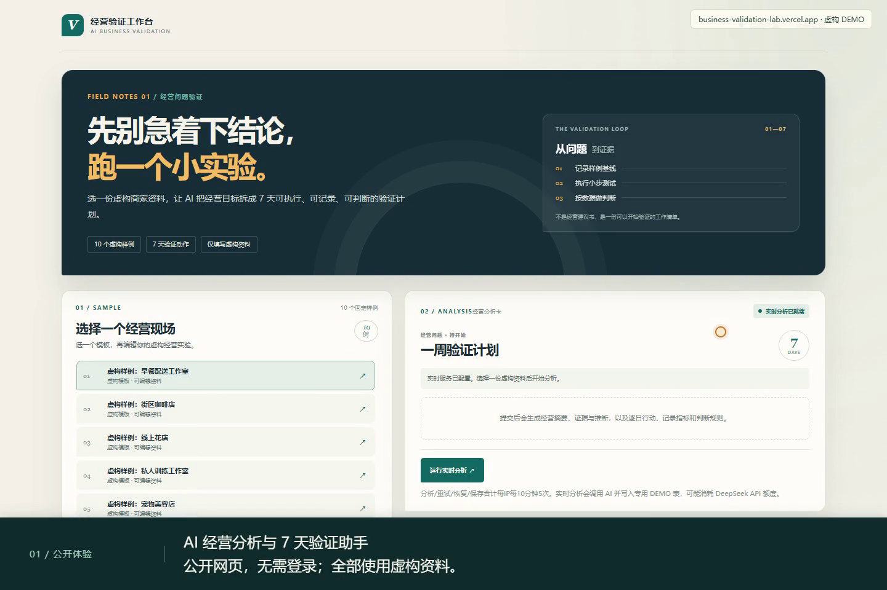
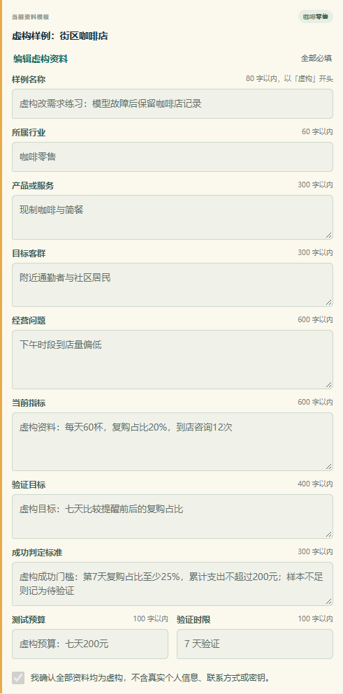
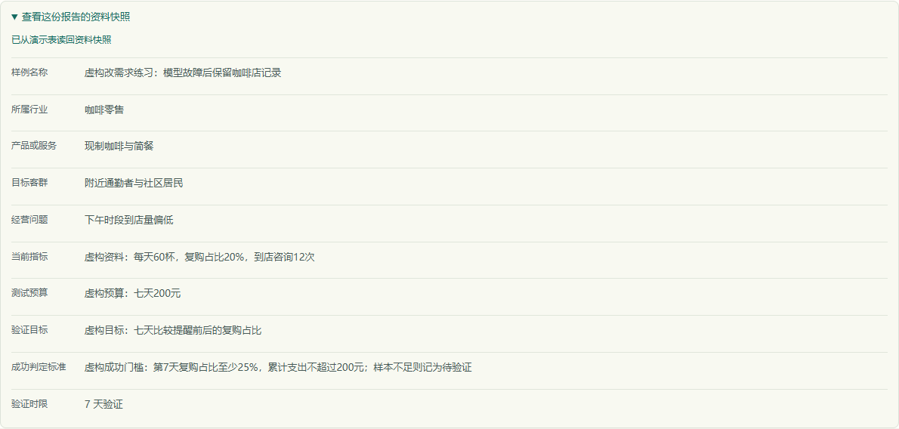
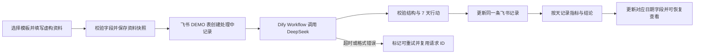

# AI 经营分析与 7 天验证助手

一个面向小微商家的 AI 经营分析演示：从虚构模板填入并编辑经营资料，经过 FastAPI → Dify Workflow/DeepSeek → 飞书多维表格，生成经营分析和 7 天验证计划，再逐天保存执行指标与结论。

项目仓库：[business-validation-lab](https://github.com/Heart727/business-validation-lab)。

公开演示：[经营验证工作台](https://business-validation-lab.vercel.app/)（无需登录，可运行实时分析）。

> **历史真实流程已验收（九字段版本）。** 2026-10-12，10 份不同虚构资料通过本地 FastAPI API 调用真实 Dify/DeepSeek 与飞书，完成报告生成、资料快照读回、同一请求重试和执行记录保存。详见 [验收记录](docs/live-acceptance.md)；这 10 次不是模拟服务，也不是对生产网站连续发起的 10 次请求。外部服务的额度和可用性会影响后续运行。

选择模板后可修改十个经营字段（新增必填的「成功判定标准」），确认全部为虚构再提交。成功报告保存在飞书；浏览器可恢复最近一次报告，按天填写状态、观察指标和结论。保存日志不再次调用 AI。本地未启用实时模式时，仍提供明确标记的固定离线预览。

2026-10-13 已用无登录浏览器在公开网站完成「编辑资料 → 实时分析 → 保存日志 → 刷新恢复」，详见 [线上验收证据](docs/production-browser-verification.json)。

第一次使用请看 [保姆级教程](docs/user-guide.md)。求职介绍可用 [项目案例](docs/case-study.md) 和 [简历项目条目及面试脚本](docs/resume-project.md)。

面试展示材料：[一页项目案例 PDF](https://business-validation-lab.vercel.app/static/demo/project-case.pdf) · [两分钟讲解与现场验证清单](docs/interview-quickstart.md)。

改需求练习：[亲自验证教程](docs/change-request-exercise.md) · [受控模拟验收](docs/change-request-acceptance.json) · [本轮真实飞书与公开恢复证据](docs/change-request-live.json) · [统计口径复核与七个计算样例](docs/metric-review.md)。试单准备：[询盘消息草稿](docs/paid-pilot-inquiry.md) · [一个表格接 AI 的范围与验收模板](docs/paid-pilot-scope.md)。


## 90 秒操作演示

[](https://business-validation-lab.vercel.app/static/demo/index.html)

[观看视频](https://business-validation-lab.vercel.app/static/demo/index.html) · [下载 MP4](static/demo/project-demo.mp4) · [讲解文本与录制说明](docs/demo-video.md)

配有中文字幕和中文合成讲解。视频读取此前已通过真实接口生成的报告，并实际保存日志、刷新读回；本次录屏没有重新调用 AI。全部为虚构演示资料。

## 截图






当前表单与资料快照截图来自 2026-10-14 的改需求验收；摘要和执行记录图读取 2026-10-12 的历史虚构样例。各次验收与版本分别留有记录。

离线回退的桌面和手机截图保留在 [docs/screenshots](docs/screenshots/)；它们明确标记为静态预览。

## 它解决什么问题

小商家常凭直觉决定要不要做促销、投广告或调整服务，却缺少一套轻量方法来记录基线、提出可验证的判断、安排下一步。这个演示把一份经营问题整理为证据、推断、缺失信息和 7 天行动，帮助使用者先跑一个小实验，再根据指标决定是否继续。

项目内置 **10 份虚构**商家模板。公开表单接受有长度限制的经营字段，需要确认全部为虚构；不提供姓名、电话或邮箱字段，服务端拒绝明显联系方式和密钥，但检测无法保证识别所有个人信息。写入的记录标记为 `DEMO`。

## 主要流程



应用通过 Pydantic 校验模型输出：必须有 7 个不同日期（第 1–7 天），观察中分别包含有内容的「证据」「推断」「缺失信息」。Dify 或飞书失败时，公开 API 只返回稳定错误码，不透传上游错误正文或密钥。

## 本地运行

需要 Python 3.12 或更新版本。无需外部账号即可打开 UI、查看离线静态预览并运行完整测试。

```powershell
python -m venv .venv
.\.venv\Scripts\python.exe -m pip install -r requirements.txt
Copy-Item .env.example .env
.\.venv\Scripts\python.exe -m uvicorn index:app --reload
```

浏览器打开 <http://127.0.0.1:8000/>。复制 `.env.example` 后默认 `DEMO_MODE=false`，所以实时提交会被拒绝，固定静态预览仍可浏览。保持该设置就不会调用 Dify 或写入飞书。

## API 与验证

| 路径 | 用途 |
| --- | --- |
| `GET /api/health` | 服务状态及实时演示开关状态 |
| `GET /api/scenarios` | 获取 10 个固定样例的 ID 和标题 |
| `GET /api/preview` | 获取离线固定分析结果 |
| `POST /api/analyze` | 提交已知模板 ID、UUID、私有请求令牌及虚构资料 draft |
| `POST /api/retry` | 使用原资料、UUID 与私有请求令牌恢复同一条记录 |
| `POST /api/record` | 使用记录访问令牌恢复报告、资料与执行日志 |
| `POST /api/actions` | 使用记录访问令牌保存某一天的指标、状态和结论 |

编辑后的资料与私有请求令牌摘要一起保存；同一 UUID 更换内容会返回 `request_content_conflict`。仅知道网页显示的 UUID 无法获得这份编辑记录的读写授权。旧的 scenario_id-only 请求仍可生成固定样例报告，但不签发执行记录令牌，也不能通过添加令牌升级旧记录。

运行自动化测试和无凭证的 10 样例验收：

```powershell
.\.venv\Scripts\python.exe -m pytest -q
.\.venv\Scripts\python.exe scripts\verify_mock_flow.py
```

验收脚本只使用内存假服务，不访问网络、不消耗 DeepSeek 额度、不写入飞书。`node --check static/app.js` 和 `.\.venv\Scripts\python.exe -m compileall -q app index.py scripts` 可用于检查前端语法与 Python 编译。

前端观察归类回归测试使用 Node 内置测试运行器：

```powershell
node --test tests\test_observations.cjs
node --test tests\test_frontend.cjs
```

## 配置真实集成

本地实时集成默认关闭，线上公开演示已配置并启用。`.env.example` 只列服务端环境变量名称和安全默认值；本地凭证写在被 Git 忽略的 `.env`，线上凭证只配置在 Vercel 项目环境变量中。不要把 API key 发在聊天、截图、源码、README、浏览器代码或构建日志中。

DeepSeek 凭证配置在 Dify 的模型供应商设置里；Vercel 不需要 `DEEPSEEK_API_KEY`。Dify Workflow API Key 和飞书应用凭证只由 FastAPI 服务端读取。配置指南：

服务端变量名包括 `DIFY_WORKFLOW_API_KEY`、`FEISHU_APP_SECRET`、`FEISHU_APP_ID`、`FEISHU_APP_TOKEN`、`FEISHU_TABLE_ID` 和 `FEISHU_BASE_URL`；在本地 `.env.example` 中查看完整清单。

- [飞书多维表格字段与权限](docs/feishu-table-fields.md)
- [Dify Workflow 与 DeepSeek](docs/dify-workflow.md)
- [失败场景、恢复方式与限制](docs/failure-cases.md)

外部服务可能产生费用或用量消耗：DeepSeek 按账户当前价格计费，Dify 受工作空间额度和套餐限制。维护线上演示时需持续检查用量；如果额度不足，应暂停实时入口。

### 公开演示的保护措施

当前线上配置如下，最近一次补齐于 2026-10-12：

1. 飞书应用只获得本项目所需的多维表格访问权限，并写入独立演示表；表内只允许虚构样例，禁止复用真实客户数据。
2. Dify Workflow 已发布，DeepSeek 供应商凭证仅保存在 Dify；Workflow 的 API key 保存在 Vercel 服务端环境变量。
3. Vercel WAF 已发布限流规则，匹配 `/api/analyze`、`/api/retry`、`/api/record`、`/api/actions`，每个来源 IP 每 10 分钟**合计最多 5 次**。恢复和保存也占用额度，连续保存七天需等待下一窗口。
4. DeepSeek/Dify 用量与费用已检查。预付费余额和平台额度仍可能耗尽，需持续监测。

规则可用 Vercel Hobby 的 WAF 能力配置；部署时请以账户控制台当前功能与额度为准。参见 [Vercel Firewall 使用说明](https://vercel.com/docs/vercel-firewall/vercel-waf/usage-and-pricing) 和 [Vercel Python Runtime](https://vercel.com/docs/functions/runtimes/python)。函数时限在 [vercel.json](vercel.json) 中保守设为 60 秒。

## 部署

仓库根目录是 Vercel Root Directory，已连接 GitHub 和 [正式公开地址](https://business-validation-lab.vercel.app/)。实时服务就绪时 `/api/health` 返回 `live_demo_enabled=true`。本地 `.env.example` 仍保持 `DEMO_MODE=false` 作为安全默认值。完整验收记录区分本地真实集成、模拟测试及生产浏览器核验，不把单次成功当作长期可用性保证。

已有专用演示表升级时，可先运行 `scripts/prepare_live_table.py` 查看缺失字段，确认后加 `--apply` 创建。真实验收命令为 `python scripts/verify_live_flow.py`；必须在该进程中配置 `DEMO_MODE=true` 和凭证，它会消耗额度、写入 DEMO 记录。私有重试状态保存在被 Git 忽略的 `.live-acceptance-state.json`，公开结果不含令牌或密钥。

Vercel Python Runtime 文档列出 Python 3.12、3.13、3.14；本地可用版本由本机环境决定。

## 技术栈

Python、FastAPI、Pydantic、HTTPX、原生 HTML/CSS/JavaScript、Dify Workflow、DeepSeek、飞书多维表格、Vercel Functions、pytest。

> 应用本身没有自建 SQLite 持久层；演示记录保存在单独的飞书多维表格。关闭实时模式时，提交接口返回 `demo_disabled`。

## 项目案例

两分钟项目介绍、实现范围和已验证内容见 [docs/case-study.md](docs/case-study.md)。案例页明确区分 10 份真实集成验收、模拟失败测试及线上体验；项目使用 Codex/AI 辅助开发，个人参与范围见简历材料。
