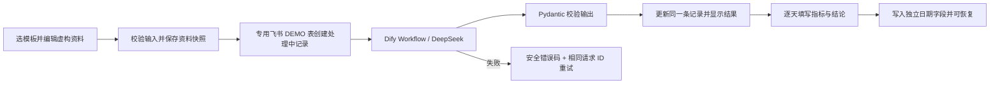
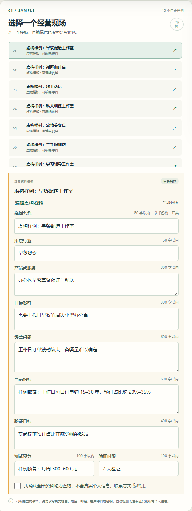
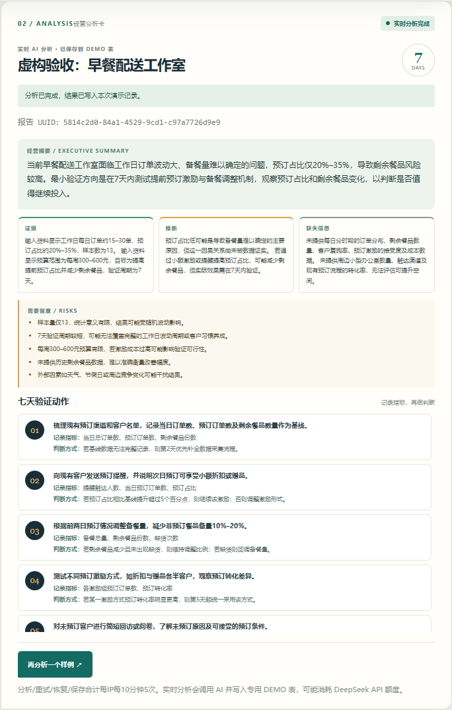
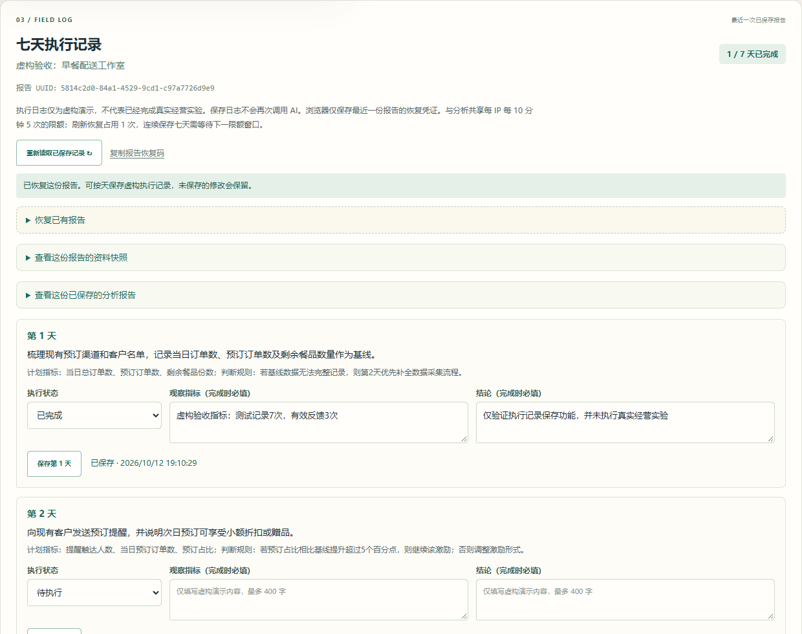
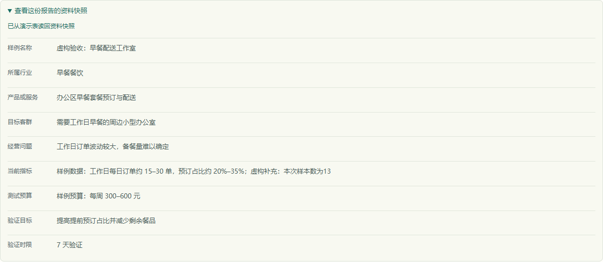

# 项目案例：AI 经营分析与 7 天验证助手

代码：[GitHub 项目仓库](https://github.com/Heart727/business-validation-lab)。

演示：[公开实时演示](https://business-validation-lab.vercel.app/)（无需登录，只使用虚构样例）。

访客从 10 份虚构模板填入并编辑经营资料，确认全部为虚构后提交分析。资料快照、摘要、证据、推断、缺失信息、风险和七天动作保存到独立飞书 DEMO 表；随后按天保存执行状态、观察指标与结论，并可恢复已保存报告。

## 需求

小商家会面对“要不要做活动、投放或调整服务”的日常决定，但常常缺少明确基线、验证指标和结束条件。本项目把一个经营问题转成一份有证据边界、风险说明与时间安排的 7 天小实验计划。

## 流程

## 实现与工程决策

- FastAPI 同时提供静态页面与 JSON API；资料表单只接受九个有长度限制的经营字段，要求虚构确认，拒绝明显联系方式、密钥和额外字段。
- Pipeline 先按请求 ID 查表，保存资料快照和私有请求令牌摘要。同一 UUID 更换输入返回冲突；重试复用原资料、私有令牌和记录。
- AI 结果必须包含结构化摘要、证据/推断/缺失信息、风险，以及第 1 至第 7 天各一项行动；不合格输出不能标记为完成。
- 外部请求有超时，公开 API 返回稳定错误码，不向访客透出上游响应正文或密钥。
- 成功后签发仅授权本条记录的访问令牌；浏览器保存最近报告，可按天记录和恢复日志，日志保存不调用 AI。每天使用独立飞书字段，更新一天不覆盖其他日期。
- 线上接入独立 DEMO 表；Vercel WAF 对分析、重试、恢复与保存四个接口按来源 IP 合计限制为每 10 分钟 5 次。

## 个人参与与 AI 辅助

项目所有者提出并确认展示目标、中文体验、访客入口及权限边界，提供并授权连接平台账号。Codex/AI 辅助完成代码生成与修改、接口配置操作、自动化测试、真实调用核验和文档初稿。个人项目介绍应按本人实际参与和能解释的范围表述，不把 AI 生成代码说成全部手写，也不将虚构演示称为商业客户交付。可复制的简历条目和面试脚本见 [简历材料](resume-project.md)。

## 验证证据

2026-10-05，匿名调用线上 API 提交早餐配送工作室虚构样例，`POST /api/analyze` 返回 `completed`；用相同请求 ID 调用 `POST /api/retry`，返回同一份结果，没有创建第二条记录。返回结果包含 7 天行动和证据/推断/缺失信息，飞书 DEMO 表出现对应记录。Dify 的已发布 Workflow API 也单独完成过一次真实运行。2026-10-06，再从公开网页点击按钮完成一次实时分析，页面显示已保存的结果与第 1–7 天动作；下面的截图来自这次浏览器运行及飞书记录视图。

2026-10-12，10 份不同的编辑资料通过本地 FastAPI API 调用**真实 Dify/DeepSeek 和飞书**：全部生成完整报告，资料快照一致，原请求重试返回同一结果，第 1 天虚构执行日志保存后能够读回。原始输入和输出见 [验收记录](live-acceptance.md) 与 [JSON 证据](live-acceptance.json)。同次验收实际验证联系方式拒绝（422）、改换内容冲突（409）及伪造访问令牌拒绝（403）。

本地模拟测试另行覆盖 10 份样例和上游超时、无效输出、鉴权/读写失败。桌面与 390px 手机浏览器检查了输入纠错、报告生成、七天日志、保存后刷新恢复、切换模板不混淆旧报告和 429 时保留未保存内容；这批交互检查使用模拟集成，与上述真实调用证据分别记录。命令见 [README](../README.md#api-与验证)。

2026-10-13，公开网站用无登录浏览器完成新资料分析、执行保存与刷新恢复，三个 POST 均为 200；输入、输出与检查范围见 [生产验收证据](production-browser-verification.json)。恢复时若日志读取失败，执行表单保持锁定，避免空白值覆盖已保存内容；这一问题经过独立审查、回归测试与浏览器复现验证。

1. 公开页面选择虚构样例：

   

2. 实时结果中的摘要与观察：

   

3. 保存七天执行指标与结论：

   

4. 从飞书 DEMO 表读回本报告的资料快照：

   

上面的新界面截图读取的是这次真实验收的已保存结果，并非又一次新生成。资料快照来源为演示表读回，完整飞书记录 ID 见 JSON 证据。离线模式和手机端的旧截图保留在 `screenshots/static-preview-*.png`，图中的「静态预览」标记仅适用于本地未启用实时模式的回退体验。

## 限制

只允许从虚构模板编辑受限资料；执行日志同样是演示数据，不证明已经执行过七天真实经营实验。AI 输出是待验证假设，不保证收益。浏览器自动保留最近一条报告，恢复码持有者拥有该记录读写权；没有账号归属、完整修改历史或逐条凭证撤销。四个接口共享每 IP 每 10 分钟五次的限额，连续保存七天需分窗口；分布式滥用、外部额度和函数时限仍是限制。演示失败时保留明确标记的离线预览。
