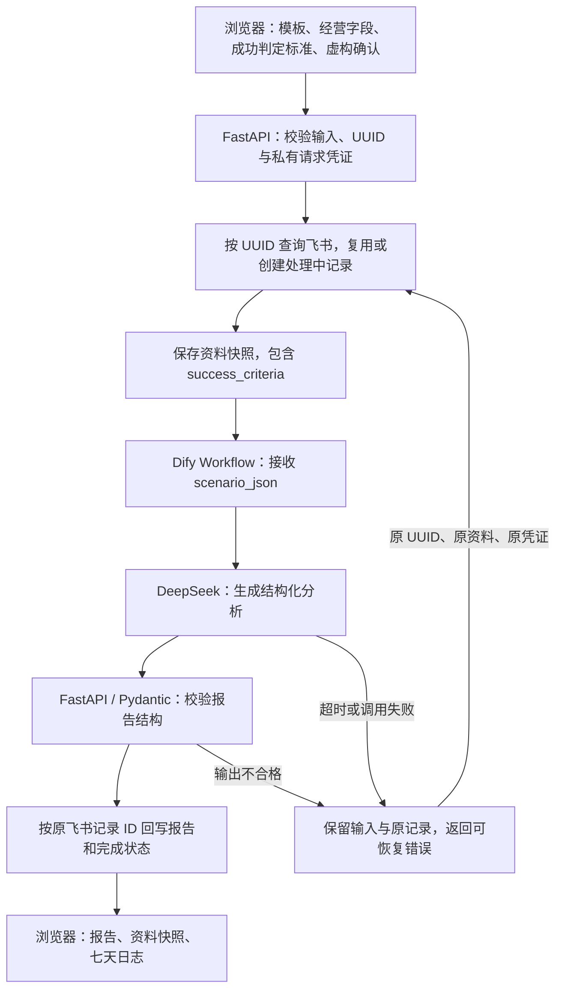

# 改需求练习：新增成功判定标准，亲自核对整条流程

本练习在现有个人项目上完成了一项需求变更：可编辑资料新增必填 `success_criteria`（成功判定标准），同一请求重复提交复用飞书记录，AI 失败后保留输入和原记录，允许使用原资料恢复。

**当前实现、本地验证与公开真实恢复分别记录。** 主代理提供的本轮实测结果为 Python **212 passed**、JavaScript **39 passed**。[验收脚本](../scripts/verify_change_request.py) 已运行并写入 [mock 验收证据](change-request-acceptance.json)；[真实飞书与模拟 AI 失败证据](change-request-live.json) 已确认原记录和输入保存。公开站使用真实 Dify/DeepSeek 恢复这条记录仍为 `pending`，本轮该证据记录的新增真实 AI 调用为 0，不提前写成恢复成功。

已有 [2026-10-12 真实集成验收](live-acceptance.md) 对应当时的九个经营字段版本，不能代替 2026-10-14 新增必填标准及失败恢复的验证。

## 一、先确认需求，别把目标当作结果

`goal` 表示“希望改善什么”，`success_criteria` 表示“按什么观察值、统计口径和门槛判断本次验证是否达到目标”。它是用户提交的标准，AI 不能把它自动改写为已经达成的经营成果。

用一份完全虚构的早餐配送资料练习：

| 内容 | 教程示例，全部为虚构 |
| --- | --- |
| 经营问题 | 临时订单波动大，希望验证提前预订是否有助于安排备餐 |
| 现有指标 | 每天 40 单，提前预订 8 单，剩余餐品约 6 份 |
| 目标 `goal` | 提高提前预订占比并减少剩余餐品 |
| 成功判定标准 `success_criteria` | 七天内按“提前预订单数 ÷ 总订单数”记录，七天合计预订占比至少 30%，日均剩余餐品不超过 3 份，支出不超过表单约定预算；数据不足七天时先补齐，不宣布达标 |
| 时间限制 | 7 天验证 |

示例里的数字是演示输入，不是客户数据，也不是项目已经达到的效果。

当前规则如下：

- **新表单与新编辑请求必填**：现有九个经营字段加 `success_criteria`，共十个经营字段；虚构确认和请求凭证另计。成功标准去除首尾空白后须为 1–300 字符，缺失、为空、只有空格或超长时被拒绝。浏览器提示与 FastAPI 服务端校验均已实现。
- **标准沿流程保留**：它要进入资料快照和 Dify 的 `scenario_json` 输入，能够从飞书读回核对。七天动作的指标和判断条件应能对照用户标准解释，结构校验不等于已证明商业结论。
- **重复不新增记录**：相同 UUID、相同模板、相同资料及相同私有请求凭证，顺序重发或在约定的并发条件下重发，应关联同一条飞书记录。不同资料不得覆盖旧请求，包含只修改 `success_criteria` 的情况。
- **失败可恢复**：飞书处理中记录已创建后，AI 超时、调用失败或输出校验不合格，应保留原输入、原 UUID、原记录及恢复所需的私有状态，不假装分析完成。恢复仍使用原输入和原凭证。
- **旧九字段 draft 仅用于原请求恢复**：不含成功标准的旧编辑资料只允许提交 `/api/retry`，且必须找到已有记录、匹配私有请求凭证和原资料。无记录返回 404 `record_not_found`，不创建新记录；用它提交 `/api/analyze` 返回 422。
- **旧资料不补造标准**：历史 `Scenario.success_criteria` 缺失时保留 `None`，页面显示“旧版未填写”；整个快照缺失时明确说明缺失，不借用当前模板。旧版仅含 `scenario_id`、`request_id`、不含 draft 的固定样例调用仍兼容，与旧九字段 draft 的恢复规则分开处理。

## 二、先读懂数据经过哪里



先读这些当前实现位置，再操作页面：

| 位置 | 要能说明的问题 |
| --- | --- |
| [浏览器表单](../static/index.html) 与 [提交逻辑](../static/app.js) | 成功判定标准在哪里填写？请求发送什么？失败后是否保留原资料与私有状态？ |
| [输入与输出模型](../app/schemas.py) | 为什么服务端也要检查必填？报告如何区分证据、推断、缺失信息以及七个日期？ |
| [FastAPI 入口](../app/main.py) 与 [流程编排](../app/services/pipeline.py) | 先查表还是先调模型？相同 UUID 和不同资料怎样处理？并发保护实际覆盖什么环境？ |
| [飞书读写](../app/services/feishu.py) | 快照保存什么？创建和回写是否使用同一条记录？怎样读回核对？ |
| [Dify 客户端](../app/services/dify.py) | `scenario_json` 是否包含新增字段？谁校验 `analysis_json`？ |

浏览器不直接持有飞书、Dify 或 DeepSeek 的平台密钥。FastAPI 编排流程，Dify 调用模型；报告回写到原飞书记录，而不是由模型另建一条业务记录。

## 三、亲自验证：从页面一直看到账外保存

### 第 1 步：确认版本和运行环境

先明确正在验证哪个提交或版本，确认页面具有十个经营字段和“成功判定标准（300 字以内）”。可以按 [README 的本地运行说明](../README.md) 启动，已有本地环境时使用：

```powershell
.\.venv\Scripts\python.exe -m uvicorn index:app --reload
```

在浏览器打开终端显示的本地地址。是否接入真实 Dify 与飞书，由本地配置和实际服务实例决定；“页面在本地运行”不能说明外部服务也是 mock，也不能说明外部服务一定是真实。

记录运行日期、代码版本、入口、是否模拟服务、是否有故障注入。真实调用需要项目所有者授权账号、启用实时配置，并使用专用 DEMO 表；凭证按仓库说明保存在私有环境配置，不写进教程、截图或公开证据。

### 第 2 步：填资料，检查发送内容

1. 选择虚构早餐配送模板，填写本教程的经营问题、现有指标、目标和成功判定标准，确认全部资料为虚构。
2. 先把成功判定标准清空，尝试提交。页面应提示补齐，不能把没有标准的资料当成合法新编辑请求。
3. 补齐后打开浏览器开发者工具的 Network 面板，提交一次，找到 `/api/analyze` 请求。
4. 检查请求的 `draft.success_criteria` 与填写内容一致，并保留这次 `request_id`。查看私有请求凭证时只在本机检查，不截图、不公开或转发其内容。

浏览器的必填拦截只能证明页面行为。直接 API 请求缺少该字段、传空字符串或只传空格，还要由服务端拒绝；这一项交给本地验收工具复核。

### 第 3 步：核对飞书输入和工作流输入

使用所有者有权限的飞书账号，按本次 UUID 找到专用 DEMO 表里的记录。记下用于核对的记录 ID，检查资料快照中的 `success_criteria` 与浏览器提交内容相同。

再在有权限的 Dify 工作流运行记录中核对 `scenario_json` 输入，确认新增标准确实传给工作流，而不只是显示在页面。检查该次工作流使用约定的 DeepSeek 模型；平台界面或日志中没有对应证据时，不能仅凭代码里写着模型名称就说亲自验证了真实模型调用。

如果这一步使用的是 fake 客户端，观察的是 fake 捕获的入参和记录。把结果标为 mock，不能称为已经写入真实飞书或运行真实 Dify。

### 第 4 步：核对结构校验与同条回写

等待完成后检查：

- 页面有摘要、证据、推断、缺失信息、风险，以及第 1 至第 7 天各一项行动；每项行动有指标和判断条件。
- 报告里的判断条件可以与输入标准对照，不能把“希望达到 30%”说成“已经达到 30%”。
- 飞书对应记录变成 `completed`，报告字段已保存，记录 ID 与调用 AI 前建立的那条一致。
- 资料快照包含原标准；刷新或恢复后，读取的是保存资料，不是上方当前选中模板的新内容。

只有 AI 返回文本还不够。结构不合格不能标记完成，回写失败也不能声称已保存。校验拒绝的分支需要用受控 mock 输出验证，不能靠某次格式正确的真实结果推定所有错误分支都通过。

可以再保存一条明确标注为虚构的第 1 天日志，核对状态、观察指标、结论能够读回。日志保存不再次调用 AI；这验证记录能力，不证明已执行真实七天经营实验。

### 第 5 步：按表逐项验证需求变更

下表按现有测试、mock JSON 和真实飞书证据填写结果。自动化测试总数不等于真实 AI 调用数；其中公开站真实恢复仍待验。

| 检查 | 怎么做 | 预期与应保留证据 | 本轮结果 |
| --- | --- | --- | --- |
| 必填校验 | 页面清空标准；API 省略、传空字符串、空格或 301 字符 | 页面拦截；服务端拒绝无效新编辑请求，不创建新记录、不调用 AI | 本地测试通过；mock 脚本确认缺失字段返回 422，创建与模型计数均为 0 |
| 同 UUID 顺序重复 | 保持完整请求相同，使用原 UUID、原资料及原私有请求凭证重发 | 已完成时返回原报告，记录 ID 不变，不因重复提交新增记录 | mock 证据确认恢复及重复共用原记录；失败后成功的模拟模型尝试共 2 次，后续重复未新增尝试 |
| 同 UUID 并发重复 | 同进程调用同一 PipelineService，同时处理相同 UUID | 返回一致结果，只创建原记录；注明并发保护的运行范围 | mock 证据：8 个并发请求、1 条模拟记录、1 次模拟模型调用；另有真实飞书创建防重证据 |
| 标准变化导致内容冲突 | 保留 UUID 与私有凭证，只修改 `success_criteria` | 返回 409，原快照、报告与记录不被新标准覆盖 | 本地自动化测试通过；不将其说成本轮真实模型验收 |
| 模拟 AI 失败后恢复 | 创建处理中记录后注入 `DifyError`，取消注入再恢复 | 失败保留原输入和记录，恢复仍回写同一记录 | mock 已验证完整恢复；真实飞书已保存输入与 `retryable_failed`，公开真实 AI 恢复待验 |
| 旧九字段 draft 恢复 | 旧资料配原 UUID 与私有请求凭证提交 `/api/retry` | 已有且匹配的记录可恢复；无记录返回 404，不 create；`/api/analyze` 拒绝旧 draft | 本地自动化测试通过，覆盖原记录恢复和无记录拒绝 |
| 旧固定样例与旧快照 | 检查 scenario-only 请求；读回缺少新字段或快照的历史记录 | 固定样例调用保持兼容；标准为 `None` 时不补造，快照缺失不借用模板 | 本地自动化覆盖；浏览器模拟检查显示“旧版未填写”或快照缺失 |
| 公开站真实恢复 | 用保留的原请求恢复失败记录，接真实 Dify/DeepSeek | 完整报告校验通过并回写原真实飞书记录，输入快照保持一致 | **待验：`public_retry_status` 为 `pending`，等待实际运行后的新通知** |

重复提交必须复用原完整请求。反复点“新分析”可能生成新 UUID，验证不了幂等。未经授权或凭证不匹配的请求也不能当作合法重复提交。

并发保护分为两层：PipelineService 的按 UUID 锁协调同一进程；飞书创建请求使用由请求关联信息派生的稳定 `client_token` 防止重复创建。真实飞书已实测两个 create 请求使用相同 `client_token`，读回同一个 record ID。这说明该次真实创建防重有效，不等于已经压测多实例并发模型执行，也不构成模型调用或计费“恰好一次”保证。

## 四、mock、真实和混合测试分别怎么写

| 测试方式 | 可以据实说明 | 不能扩大为 |
| --- | --- | --- |
| FastAPI + fake Dify + fake 飞书 | 校验、流程分支、捕获的输入、模拟记录 ID 与创建次数 | 实际调用 DeepSeek 或实际飞书入库 |
| 本地 FastAPI + 真实 Dify/DeepSeek + 真实飞书 | 本地 API 连接真实服务，本次资料和结果确实保存并读回 | 公开部署也已经验证，或所有模拟故障都在生产发生过 |
| 真实飞书 + 注入 AI 失败 | 真表里原记录保留；AI 失败是人为注入，恢复按实际服务注明 | 供应商真的发生故障，或注入失败本身是一次真实模型调用 |
| 浏览器 + 真实服务 | 本次浏览器输入、请求、报告与保存行为的证据 | 不同浏览器、移动端和全部边界分支都通过 |

本轮 [验收脚本](../scripts/verify_change_request.py) 已运行，可从仓库根目录复现。它使用 fake Dify、内存飞书与 FastAPI 的 ASGI 测试入口，**无网络、无真实 AI 调用、不写真实飞书**；没有 `--live`、`--mock` 参数：

```powershell
.\.venv\Scripts\python.exe scripts\verify_change_request.py
```

脚本写入 [change-request-acceptance.json](change-request-acceptance.json)，其中记录缺失标准的 422、注入 AI 失败后的输入保留、原记录恢复与重复，以及同进程 8 个并发请求。模拟失败与恢复段合计 2 次模型尝试，属于 fake 调用，不算真实 DeepSeek 次数。

本轮真实飞书的独立证据见 [change-request-live.json](change-request-live.json)：两个 create 请求读回同一记录；测试替身注入 `DifyError` 后，真实飞书保存了原十字段输入和 `retryable_failed`。这里的模型故障是模拟的，证据尚未包含公开站真实模型恢复成功。

不要为跑并发或批量验收关闭生产保护；公开演示的分析、重试、恢复与保存共享每 IP 每 10 分钟五次限额，应等待窗口或使用已授权的本地验收环境。

## 五、失败之后怎样确认没有丢资料

针对“飞书记录已创建，AI 随后失败”的场景，逐项核对：

1. 浏览器仍保留原输入，包含成功判定标准、原 UUID 和私有恢复状态；页面没有把新模板替换成原请求资料。
2. 飞书仍能按 UUID 找到原记录和输入快照。失败状态或安全错误码与实际返回一致，未被当作完成报告。
3. 恢复前后的 `success_criteria`、模板和其他资料相同。不能一边修改标准一边用旧 UUID 重试。
4. 取消模拟失败后恢复原请求，核对回写记录 ID 不变，再读回最终报告和资料快照。mock 已完成此步；真实飞书记录的公开站真实 Dify/DeepSeek 恢复仍待验，不能预填成功。

如果第一次创建飞书记录就失败，不能声称存在一条已保留的飞书记录；应保留浏览器输入并明确保存尚未确认。飞书错误或函数中断也可能让状态更新无法确认，应查回记录后判断，不伪造失败或成功状态。

恢复码、私有请求令牌和报告访问令牌都不放进公开证据。拥有报告恢复码的人可以读取和编辑对应报告；UUID 本身不等于授权。

## 六、写下自己亲自看到的证据

每次练习按下列格式记录，空项先写“未检查”，不要替换成猜测：

| 项目 | 本次填写 |
| --- | --- |
| 日期、代码版本、运行入口 | 待填写 |
| 执行者；本人实际操作范围 | 待填写 |
| 服务方式：mock / 真实 / 混合；是否注入故障 | 待填写 |
| 虚构输入及 `success_criteria` | 待填写 |
| UUID、脱敏记录关联信息；不含私有凭证 | 待填写 |
| 浏览器请求、飞书快照、Dify 输入、结构校验与回写观察 | 待填写 |
| 重复、并发、失败恢复、旧版兼容的实际结果与运行范围 | 待填写 |
| 命令、退出码、实际输出或证据位置 | 待填写 |
| 未通过项、未检查项、已知限制 | 待填写 |

已有证据可据实说明本地校验、mock 恢复与并发，以及真实飞书创建防重和失败记录保存。公开真实恢复成功后，再根据主代理通知和更新的 JSON 核对报告、同条回写与原输入，将对应待验项更新为实测结果；当前不提前修改 `pending`，也不扩大真实 AI 次数。

## 七、个人参与怎么说

统一口径是：**“使用 Codex 辅助搭建个人项目。”** 用户负责提出与确认需求、确认使用边界，并提供和授权连接平台账号；AI 辅助完成编码、集成操作与核验。本教程鼓励本人亲自操作并理解流程，只有实际做过的步骤才能说“我亲自验证了”。

可在亲自完成后据实补充：“我检查了成功判定标准从浏览器到 FastAPI、飞书快照、Dify 输入及原记录回写的流转；测试方式和失败注入情况在证据里分别标明。” 不称全部代码为手写，不把 AI 执行的检查说成本人独立完成，也不把虚构资料称为客户或经营收益证明。
