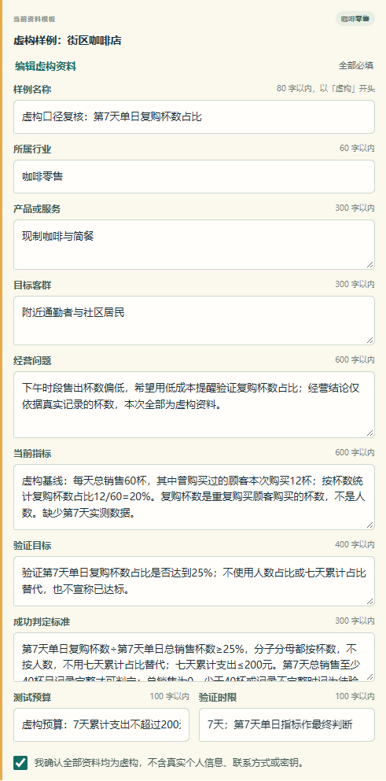
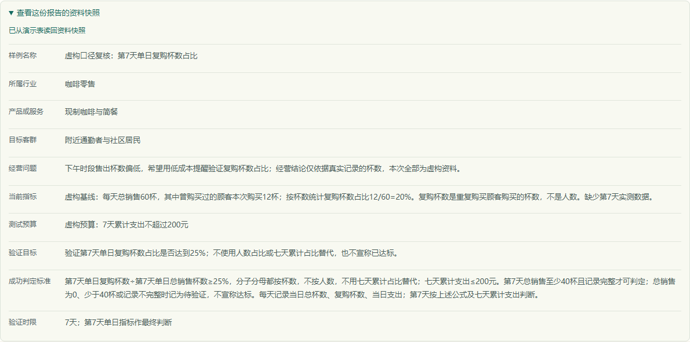

# 统计口径复核：从模糊占比到可验收规则

2026-10-14，用新请求在[公开演示](https://business-validation-lab.vercel.app/)提交虚构咖啡店资料，真实工作流生成报告，公开浏览器与独立飞书查询读回同一结果。此次补清输入定义；没有修改应用代码、Dify 工作流或原模型输出。

本次指标口径由 **Codex 辅助复核**，不代表用户已亲自验收，也不代表模型以后每次都正确。未采集真实七天经营数据，不能据此宣称经营达标。

## 前一份报告的问题

前一份报告第 1 天同时记录总杯数和复购人数，第 7 天汇总七天数据却称其为第七天指标。原报告、原 UUID 和原飞书记录均保留，见 [原始证据](change-request-live.json)。出现 `25%` 和结构校验通过，不能证明分子、分母和统计周期正确。

修改标准会改变业务输入，所以本次采用新 UUID、新私有请求凭证和新飞书记录；不覆盖原报告，不用旧 UUID 重试新标准。

## 本次约定与真实输出对照

| 验收项 | 本次输入定义 | 实际报告 |
| --- | --- | --- |
| 分子 | 曾购买过的顾客在第 7 天购买的杯数 | 第 7 天行动、指标和判断规则均使用复购杯数 |
| 分母与周期 | 第 7 天单日总销售杯数 | 第 7 天指标明确写“第7天单日复购杯数÷第7天单日总销售杯数” |
| 每日采集 | 当日总杯数、复购杯数、当日支出 | 第 1–7 天均采集这三项；不将人数用于占比 |
| 占比门槛 | 至少 25%，含等于边界 | 第 7 天判断规则保留 `≥25%` |
| 成本门槛 | 七天累计支出不超过 200 元 | 第 2–6 天关注累计支出，第 7 天保留 `≤200元` |
| 不足以判断 | 第 7 天为零、少于 40 杯或记录不完整 | 第 7 天明确标为待验证，不宣称达标 |
| 数据是否已有 | 只有虚构基线 12/60=20%；第 7 天数据缺失 | 摘要与观察承认缺少实测数据，没有声称已达到 25% |

40 杯是这份虚构样例约定的最低观察量，不表示统计显著性；报告自身也提示单日波动和稳定性限制。提醒的具体内容、触达方式和真实经营效果仍需另行验证。

## 保存与查询证据

- 公开浏览器 `POST /api/analyze` 为 200，真实工作流完成七天报告。
- 刷新后 `POST /api/record` 为 200，完整资料快照包含原统计定义。
- 独立飞书查询找到新 UUID 对应的一条记录，物理状态为 `completed`；专用成功标准列、全部资料快照与报告原文一致。
- 原报告与修改前版本一致，新记录与原记录不同；保留了前后对照。
- 生产两次 POST 均成功；没有关闭或绕过限流。本地独立飞书读回第一次遇到传输错误，安全地重复只读检查后成功；没有重新生成 AI 报告。

完整输入、模型原文、请求状态和复核结论见 [本次真实证据](metric-review-live.json)。公开证据不含私有请求凭证或报告恢复码。

## 七个计算样例：怎样判断结果正确

先看第 7 天记录是否完整、销量是否至少 40 杯，再计算当天复购杯数占比，同时检查七天累计支出。不用七天累计占比替代单日占比；也不将杯数占比写成人数占比。

| 第 7 天复购杯数 / 总杯数 | 七天累计支出 | 记录条件 | 本次约定下的判断 |
| --- | --- | --- | --- |
| 25 / 100 = 25% | 200 元 | 完整 | 达到约定门槛 |
| 24 / 100 = 24% | 200 元 | 完整 | 未达到占比门槛 |
| 25 / 100 = 25% | 201 元 | 完整 | 超出预算，不能判为达标 |
| 0 / 0，比例未定义 | 0 元 | 完整 | 待验证，不做除零计算 |
| 10 / 30 ≈ 33.33% | 50 元 | 完整，但不足 40 杯 | 待验证 |
| 25 / 100 = 25% | 100 元 | 不完整 | 待验证 |
| 8 / 40 = 20% | 200 元 | 完整；七天累计 180 / 600 = 30% | 单日未达标，累计 30% 不能替代 |

这七项已通过离线精确分数计算，见 [计算证据](metric-acceptance-examples.json)。它们是虚构算例，未调用模型、未写飞书，也不是七次真实经营验收。

## 你自己怎么复现

1. 打开公开演示，选咖啡店模板，将当前指标、目标、成功标准按本页定义填写。先使用虚构资料，确认后点击实时分析。
2. 第七天逐项核对分子、分母、周期、25% 门槛、200 元预算和数据不足条件。再检查第 1–6 天采集的是不是同一单位。
3. 刷新并展开资料快照，确认标准没有被模板替换。记录 UUID 和检查日期，私有恢复凭证只保存在自己控制的环境中。
4. 用上表算例解释判断，尤其检查“零销量”和“累计达标但单日未达标”。如果报告仍混用口径，标记内容未通过，保留原文；修订输入后另开新请求，不修改旧输出伪装通过。

公开站分析、恢复和保存共享每 IP 每十分钟五次限额，不要连续反复刷新或批量调用。算例核对可以离线完成，不需要不断生成新报告。

完成本人复现后，再按[改需求练习记录表](change-request-exercise.md#六写下自己亲自看到的证据)写下实际负责的操作。试单准备可使用[询盘草稿](paid-pilot-inquiry.md)与[范围模板](paid-pilot-scope.md)。
